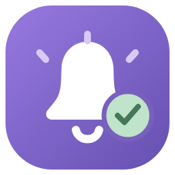
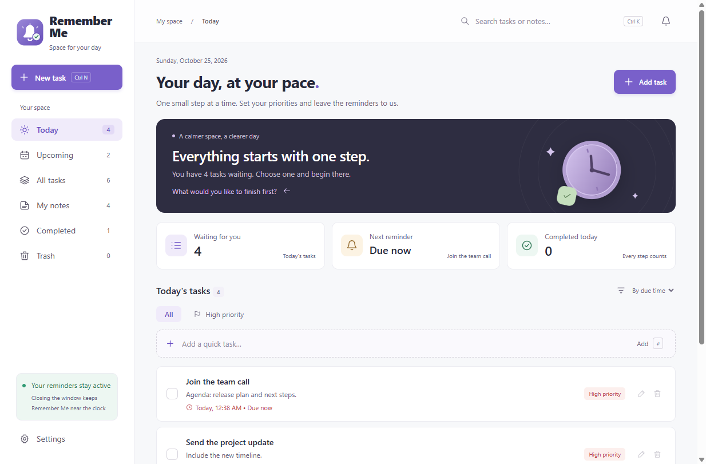
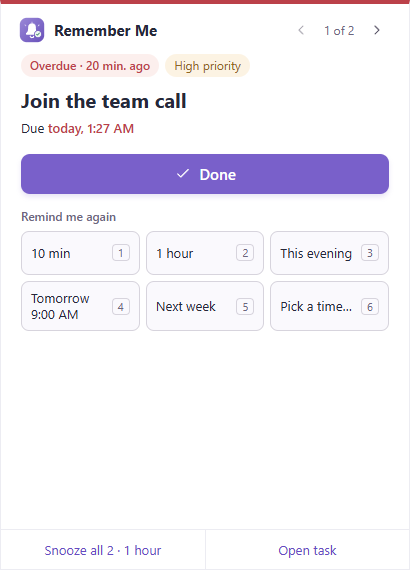
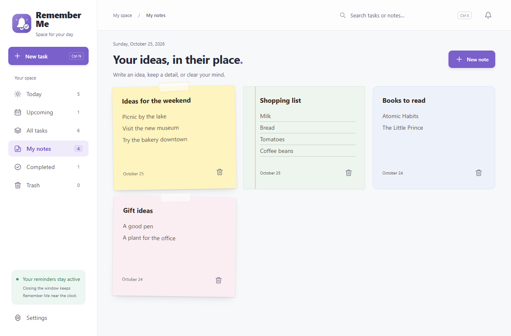
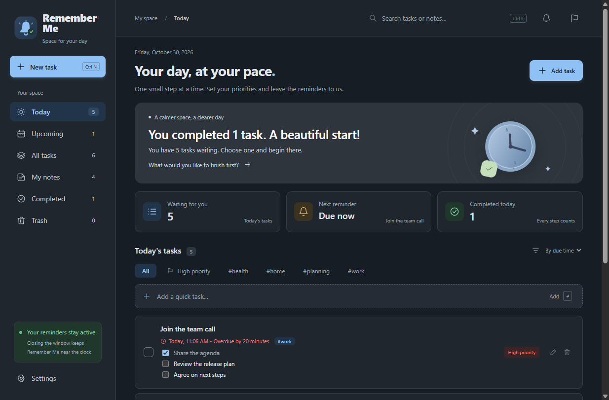

# Remember Me

<p align="center">
  
</p>

<p align="center">
  <a href="https://github.com/sarmadiq9090-coder/Remember-Me/actions"></a>
  <a href="https://github.com/sarmadiq9090-coder/Remember-Me/releases/latest"></a>
  <a href="LICENSE"></a>
  
</p>

<p align="center"><strong>A task, note and reminder app for Windows whose alerts stay on screen until you deal with them.</strong></p>

Remember Me is an open-source desktop app for 64-bit Windows. It runs without an account or a permanent internet connection, keeps your data on your own device, and shows each reminder in a sticky window above the taskbar until you mark it done or snooze it. Missed reminders don't get lost in the notification center.

<p align="center">
  
  
</p>

<p align="center">
  
  
</p>

<p align="center">In Arabic: <a href="docs/screenshots/main-ar.png">main window</a> · <a href="docs/screenshots/alert-ar.png">reminder</a></p>

## Features

- **Sticky reminders:** a persistent alert above the taskbar, shown on top of other windows until you choose **Done** or snooze it. It shows how overdue a reminder is, its priority and repeat, and the next occurrence; when several are waiting it shows them one at a time with a *1 of N* counter, and **Open task** opens the task itself.
- **Smart snooze:** 10 minutes, 1 hour, this evening, tomorrow at 9 AM, next week, or any date and time you pick, on the 1–6 keys, plus **Snooze all** when several reminders are waiting. Snoozes survive restarts.
- **Recurring tasks:** daily, weekly, monthly, yearly, on chosen weekdays (for example workdays), or every few days. Completing one logs it under *Completed* and schedules the next occurrence at the same wall-clock time, including across daylight-saving changes. Monthly repeats on the 31st and yearly repeats on February 29 fall back to the last day of the month without drifting.
- **Skip this time and Only this time:** skip one occurrence of a repeating task without marking it done, or move just one occurrence and keep the rest of the series.
- **Early notice:** an optional Windows notification from 5 minutes to 1 day before a reminder is due.
- **Remind me again:** while an alert is unanswered, its sound can repeat every 2, 5 or 15 minutes, up to 6 times.
- **Pause reminders:** from the notification-area menu, for 1 hour, until tomorrow at 8:00, or until you resume. Nothing pops up or sounds meanwhile, and reminders that came due appear when the pause ends.
- **Undo and Trash:** undo Done from the main window or the alert, and undo a delete from its message. Deleted tasks and notes wait 30 days in the Trash and can be restored.
- **No dropped alerts:** several due reminders are queued and shown one at a time, with a count of how many are waiting.
- **Notes:** notes you can edit, search and delete, on ten paper colors as a plain card, a sticky note or lined paper.
- **Attachments:** add PDFs, Excel sheets, documents, images or any other file to tasks and notes, up to 20 files per item and 50 MB per file. Images preview inline, including in the alert.
- **Safe file handling:** programs, scripts, installers and shortcuts are revealed in File Explorer instead of being launched.
- **Smart search (Ctrl+K):** searches tasks and notes, and matches Arabic text regardless of diacritics and common spelling variants.
- **12 interface languages:** English (the default), العربية (a full right-to-left interface), Español, Français, Deutsch, Português (Brasil), Русский, 中文 (简体), 日本語, Türkçe, हिन्दी and Bahasa Indonesia, switchable in Settings. Dates, numbers and plurals follow the chosen language, and mixed-language text keeps its reading order. The translations other than English and Arabic are machine-assisted; corrections from native speakers are very welcome (see [Translations](#translations)).
- **Tags and checklists:** tag tasks, filter the list by tag and find tags in search, sort tasks by due time, priority, newest or title, and break a task into steps you tick off from the list; a repeating task starts each occurrence with its steps unticked.
- **Local-first data:** atomic saves, an automatic `.bak` copy and automatic recovery if the data file is damaged.
- **Backups:** export a full backup with all attachments and checksums, restore one from Settings after it's verified, or copy daily backups into a synced Google Drive folder.
- **Themes and display options:** light, dark or follow Windows, six color palettes (Lavender, Ocean, Forest, Sunset, Graphite and High contrast), and the first day of the week (Saturday by default). Dates and times always use Western digits (0-9), in Arabic too.
- **Multi-monitor aware:** the alert sits above the taskbar wherever it is (bottom, top, left or right) and adapts to scaled and secondary displays.
- **Runs in the background:** closing the window keeps Remember Me in the notification area, and it can start with Windows. The icon shows a dot while reminders are waiting, and Remember Me warns you if Start with Windows is off while reminders are still to come.
- **Optional automatic updates:** with your permission, new versions are downloaded from GitHub Releases and installed when you restart.
- **About and support:** the version, links to the source code, release notes and problem reports, a local log, and diagnostic info to copy into a report.

## Install

Download the latest installer from [Releases](https://github.com/sarmadiq9090-coder/Remember-Me/releases/latest) and run it on Windows 10 or 11 (64-bit). Your personal data never goes into the repository or the installer.

### Verify the download

The installer is built by GitHub Actions from the published source. It is not code-signed yet, so Windows SmartScreen may show "Windows protected your PC". Choose **More info**, then **Run anyway**, once you've verified the file.

Compare the file's fingerprint with `SHA256SUMS.txt` from the same release:

```powershell
Get-FileHash .\Remember-Me-Setup-1.5.0-x64.exe -Algorithm SHA256
```

With the GitHub CLI you can also confirm the file was built by this repository's release workflow from the release tag:

```powershell
gh attestation verify .\Remember-Me-Setup-1.5.0-x64.exe --repo sarmadiq9090-coder/Remember-Me --source-ref refs/tags/v1.5.0 --signer-workflow sarmadiq9090-coder/Remember-Me/.github/workflows/release.yml
```

### Upgrading from v1.4.0 or earlier

Older versions stored their data in `%APPDATA%\Waqt`. The first time a newer version starts, it moves that folder to `%APPDATA%\Remember Me` automatically. If the folder can't be moved, Remember Me copies it, checks the copy and keeps the original as `%APPDATA%\Waqt.migrated-<date>`. It never deletes the old folder.

### Updating

From v1.5.0, Remember Me can update itself from this repository's [Releases](https://github.com/sarmadiq9090-coder/Remember-Me/releases). The first time it starts, it asks whether it may check GitHub for new versions. Nothing else is sent.

- If you allow it, it checks about 30 seconds after starting and then once a day, and downloads new versions in the background.
- When a version is ready, a banner offers **Restart now** or **Later**. Otherwise it installs the next time you quit the app. Remember Me never restarts on its own.
- Before installing, it saves a safety copy of your data in the `backups` folder.
- **Settings → Updates** turns automatic checks on or off, and **Check now** works either way.

v1.4.0 can't update itself: install the next version from Releases once by hand, and later versions arrive automatically.

## Usage

- **New task:** a title, notes, a priority and an optional reminder time.
- **Today:** tasks without a date, today's tasks and anything overdue. **Upcoming:** tasks due after today.
- **Multiple reminders:** shown one after another, with no task skipped.
- **Tags:** in the task editor, type up to ten tags separated by commas; tags you already use are suggested. Every tag in use becomes a filter button above the list, and search finds tags too. The menu next to the list title sorts by due time, priority, newest first or title.
- **Checklists:** add up to 50 steps in the task editor (Enter adds the next one) and tick them from the task card.
- **Recurring tasks:** missed occurrences roll forward to the next future one when you complete the task. Snoozing never changes the original repeat time. The skip button on a repeating task moves it to the next occurrence without logging it as done. When you change a repeating task's time, tick **Only this time** to move just this occurrence.
- **Done and delete:** both show an **Undo** button for a few seconds. Deleted items go to **Trash**, where you can restore them or delete them for good; they're removed automatically after 30 days.
- **Attachments:** while editing a task or note, choose **Add files**. Files are copied into Remember Me's data folder, so moving or deleting the original doesn't break the attachment. Removing an attachment from one item doesn't affect other items.
- **Opening files:** click an attachment to open it with the default Windows app. Excel files need a compatible app such as Excel.
- **Settings:**
  - *Reminders and background:* alert sound, **Remind me again**, start with Windows, alert position (left or right), interface language, and a preview alert.
  - *Appearance:* light, dark or same as Windows, and one of six palettes, picked from preview cards. The change shows at once in the main window and the alert.
  - *Calendar:* the first day of the week.
  - *Your data:* export, restore, storage use and cleanup, the data folder, and Google Drive backups with how many automatic copies to keep.
  - *Updates:* automatic checks and **Check now**.
- **About:** at the end of Settings, or **About Remember Me** in the tray menu. It shows the version, links to the source code, release notes, problem reports, the privacy notice and the MIT license, and has **Check for updates** and **Open log folder**. **Copy diagnostic info** copies the app, Electron, Chromium and Windows versions plus the interface language and theme, to paste into a problem report. It never includes your tasks, notes, files or folder paths.
- **Shortcuts:** Ctrl+N creates a task or note, Ctrl+K focuses search.

The bell button at the top shows a **preview alert**. Snoozing a preview only closes it, while reminders you set on tasks are real.

## Running in the background

Closing the main window keeps Remember Me running next to the Windows clock. Its icon may be under the hidden-icons arrow. Click it to open the app, or right-click it to quit completely.

To stop reminders for a while, right-click the icon and choose **Pause reminders**: for 1 hour, until tomorrow at 8:00, or until you resume. Nothing pops up or makes a sound during a pause. Reminders that come due wait and appear when it ends, or when you choose **Resume reminders**. A pause continues after a restart.

Turn on **Settings → Start with Windows** to start reminders automatically when you sign in. It's off by default.

Alerts can't appear while the PC is off or asleep, or while the app isn't running. Missed reminders appear as soon as you return. Remember Me doesn't wake the PC, uses your device's local time, and doesn't appear over the secure Windows lock screen.

## Data and backups

Everything is stored locally in `%APPDATA%\Remember Me\data.json`, with the previous version kept in `data.json.bak`. Settings shows the exact path and a button to open it. Saves are atomic. If the main file is ever damaged, Remember Me restores the backup automatically and keeps the damaged file for inspection.

**Export backup** creates a new folder with `data.json`, an `attachments` folder containing every file linked to your tasks and notes (including completed tasks), and `backup.json` with a SHA-256 checksum for each file.

**Restore from backup** in Settings brings a backup back:

- Remember Me checks every file against its checksum first and shows the number of tasks, notes and attachments for you to confirm.
- Before replacing anything, it saves a safety copy of your current data in the `backups` folder.
- Settings that belong to this PC (start with Windows, automatic updates and a pause) stay as they are.
- Backups made before checksums existed can still be restored. Remember Me only checks that their files are present and the right size, and labels them "unverified".

Settings also shows how much space attachments and backups use, and can clean up attachment files that no task or note uses any more.

The data folder also holds a small log, `logs\remember-me.log` (at most three 1 MB files), that you can attach to a problem report: **Settings → About → Open log folder**. It records app events and errors, never the titles or text of your tasks and notes, or file names.

To restore a backup manually instead:

1. Quit Remember Me from its notification-area menu.
2. Keep a copy of your current data.
3. Copy `data.json` and the `attachments` folder from the backup into the data folder.
4. Start the app.

Don't edit the data file while the app is running.

Updating from an earlier version keeps your tasks, notes and settings automatically.

### Google Drive backups

1. In Settings, choose **Install Google Drive and sign in** to get [Google Drive for desktop](https://www.google.com/drive/download/), then sign in.
2. Create a folder inside Google Drive, for example **Remember Me Backups**. In Remember Me, choose **Choose Google Drive folder** and select that synced folder.
3. Choose **Back up now**. A full local copy is saved in `%APPDATA%\Remember Me\backups`, then copied with all images and attachments into the Drive folder.
4. Google Drive uploads it to your account. Check the Drive icon or the Drive website to confirm the upload finished.

**Automatic daily backup** creates a copy every 24 hours while the app is running. If the Drive folder is unavailable, the local copy is kept and the copy to Drive is retried every 15 minutes. If the folder stays unavailable for more than a day, for example because Drive is signed out, Settings shows a warning.

To save space, you can choose to keep only the latest 5, 10 or 30 automatic backups. By default all of them are kept. Rotation asks for confirmation, and it never deletes backups you exported yourself or safety copies. No Google Cloud keys or paid add-ons are needed: sign-in and syncing are handled by the official Google Drive app.

## Development

Built with Electron, JavaScript, HTML and CSS. The interface is isolated from Node.js (`contextIsolation`, `sandbox`, a strict Content Security Policy and validated IPC); storage and scheduling run in the main process, and the UI loads nothing from the internet. The only network access is the optional update check, made by the main process.

```sh
pnpm install
pnpm start
pnpm test
pnpm run package
pnpm run installer
```

Requires Node.js 22 or newer and pnpm 10. `pnpm run package` produces a portable build in `release/v<version>`, and `pnpm run installer` produces an NSIS installer in `release/installer`.

`pnpm run screenshots` retakes the pictures in `docs/screenshots` (`tools/desktop-screenshots.cjs`): it runs the app in test mode with made-up sample tasks and notes in a temporary data folder, in English and Arabic, light and dark, so no personal data ends up in the repository. It needs Playwright, a devDependency.

`pnpm run assets` redraws the icons in `assets/` with Electron: `icon.ico` with 10 sizes from 16 to 256 px (16-32 px use the simpler `icon-small.svg` glyph without rays), `icon.png`, and the tray images `tray.png` and `tray-waiting.png` with `@1.5x` and `@2x` versions. It also writes [`docs/icon-preview.png`](docs/icon-preview.png), every size on a light and a dark taskbar.

### Tests

- `tests/core.test.js`: scheduling, repeats, snoozing, saving and recovery.
- `tests/scheduling.test.js`: repeats across daylight-saving time, time-zone changes and the clock moving backwards; 20 reminders in the same minute; a full day of missed reminders among thousands of tasks.
- `tests/ipc.test.js`: only the app's own pages are accepted, the alert window gets a limited set of actions, and payloads are validated, including About links, which must be one of six fixed IDs.
- `tests/about.test.js`: the About links are exact GitHub addresses, and diagnostic info holds only versions, language and theme.
- `tests/icons.test.js`: every size in `icon.ico` and the tray images' dimensions.
- `tests/search.test.js`: Arabic-aware search matching.
- `tests/i18n.test.js`: every message has English text, every locale is complete, translations keep placeholders and plural forms, fallbacks to English, and saved languages are kept.
- `tests/placement.test.js`: placing the alert next to a taskbar on any edge, on scaled and secondary displays.
- `tests/interchange.test.js`: CSV and iCalendar import and export.
- `tests/alert-format.test.js`: the alert's snooze presets, overdue age and due day, across daylight-saving changes.
- `tests/theme.test.js`: every palette in light and dark meets WCAG contrast for text, buttons, focus rings and the logo; the stylesheets use only theme tokens; palette, note color and note style settings fall back safely.
- `tests/pause.test.js`: pausing reminders from the tray, with a fake clock.
- `tests/early-notices.test.js`: each "coming up" notice shows once per due time, none pile up after a pause, and clicked or old notices are let go.
- `tests/focus.test.js`: a rebuilt list gives focus back to the same control of the same item, or to the next item when it is gone.
- `tests/structure.test.js`: every `require` and import, every script and stylesheet the pages load, and every fixed path the main process builds exists.
- `tests/handlers.test.js`: every allowed IPC action has exactly one handler, and only actions that change nothing skip the rescan.
- `tests/winget-manifest.test.js`: the winget manifests written from a release's `SHA256SUMS.txt`.
- `tests/updates.test.js`: the update consent, background schedule, Check now, the ready banner, and installing after a safety backup.
- `tests/data-folder.test.js` and `tests/login-item.test.js`: moving the old `Waqt` data folder, including locked and interrupted moves, and pointing start with Windows at the renamed executable.
- `tests/attachments.test.js`, `tests/backups.test.js` and `tests/drive-backup.test.js`: copying, export, checksums, restore, rotation, migration, validation and Drive-folder recovery.
- `tests/formatting.test.js` and `tests/logger.test.js`: Western digits in dates and times, and a log that rotates and never records task or note content.
- **Desktop tests (Playwright):** `tests/desktop-smoke.cjs`, `tests/attachments-desktop.cjs` and `tests/photos-drive-desktop.cjs` drive the real Windows app with temporary data. Run the smoke test with `pnpm test:desktop`; set `WAQT_EXECUTABLE` to a packaged `Remember Me.exe` to test a build instead of the sources. Playwright is a devDependency; the attachments suite also needs JSZip (or the `WAQT_PLAYWRIGHT` and `WAQT_JSZIP` paths). `.github/workflows/desktop.yml` packages the app and runs the smoke test on every pull request.
- **Release QA (Playwright):** `pnpm test:release-qa` runs `tests/release-qa/` against a packaged desktop-test build (`WAQT_DESKTOP_TEST_BUILD=1 pnpm run package`, then `WAQT_EXECUTABLE` pointing at its exe): first start and old data, every repeat type, the alert (keyboard guard, presets, Pick a time, Snooze all, Done and Undo, Skip, Open task), early notices, notes, tags, checklists, trash, all palettes in light and dark, About, updates, attachments, export and restore, storage cleanup, and untranslated text in Arabic and Russian. Each run uses test mode and temporary data, and stubs dialogs and links.
- `pnpm lint` runs ESLint (`eslint.config.cjs`); CI runs it after the unit tests.

### Translations

English is the source language. The pages and scripts contain English text; each translation lives in `ui/locales/<code>.json` and maps the English text (the key) to the translation, and any missing entry falls back to English. Messages with a count use plural forms (`zero`, `one`, `two`, `few`, `many`, `other`, as defined by the language), and `{name}` placeholders must be kept.

- **Fix a translation:** edit the language's JSON file and open a pull request, or report the problem with a [Translation review issue](https://github.com/sarmadiq9090-coder/Remember-Me/issues/new?template=translation.yml). Native speakers are especially welcome to review the machine-assisted languages. [TRANSLATING.md](TRANSLATING.md) explains the file format, plurals, placeholders and how to check your text in the app.
- **Add a language:** add an entry to `LOCALES` in `ui/lib/translate.js` (code, its own name, `ltr` or `rtl`, the `Intl` locale, the Chromium `.pak` name and the first day of the week), then copy `ui/locales/en.json` to `ui/locales/<code>.json` and translate the values. The packaged app keeps Chromium's built-in strings for every language listed there.
- **Check:** `node tools/i18n-keys.cjs` lists the keys each language is missing, and `pnpm test` fails if English is incomplete, Arabic is incomplete, or a translation drops a placeholder.

### Releasing

Bump `version` in `package.json` and push a matching tag, such as `v1.4.1`. `.github/workflows/release.yml` runs the tests, builds the installer and publishes it to Releases with `SHA256SUMS.txt`, build provenance, and the `latest.yml` and `.blockmap` files the app's updater reads. Running the workflow by hand only builds the files: it creates no release and no attestation. [RELEASING.md](RELEASING.md) has the full checklist, and [docs/distribution/winget](docs/distribution/winget/README.md) the winget manifests.

## Code signing policy

Windows releases are being prepared for code signing through the SignPath Foundation open-source program (application pending). Once approved:

Free code signing provided by [SignPath.io](https://signpath.io), certificate by [SignPath Foundation](https://signpath.org).

Every signed file is built automatically by GitHub Actions from this repository, and every release needs manual approval before it's signed. Release installers are also published with `SHA256SUMS.txt` and GitHub build provenance (see [Verify the download](#verify-the-download)).

Team roles:

- **Committers and reviewers:** [@sarmadiq9090-coder](https://github.com/sarmadiq9090-coder). Changes from anyone else arrive as pull requests and are reviewed before merging.
- **Approvers:** [@sarmadiq9090-coder](https://github.com/sarmadiq9090-coder), the repository owner.

## Privacy

This program will not transfer any information to other networked systems unless specifically requested by the user or the person installing or operating it.

In detail:

- Tasks, notes, attachments and settings are stored only on your device. Remember Me has no account, analytics or telemetry.
- Backups are copied only to folders you choose. For a Google Drive folder, Google's own Drive app does the syncing, under Google's privacy policy.
- Links you click, such as the Google Drive download page, open in your default browser.
- If you allow automatic updates, or choose **Check now**, Remember Me contacts GitHub Releases for this repository to check for and download new versions. That's a standard HTTPS request, covered by [GitHub's privacy statement](https://docs.github.com/site-policy/privacy-policies/github-general-privacy-statement), and none of your data is included.

## Acknowledgements

The task and note layout was inspired by [TickTick for Windows](https://www.ticktick.com/windows), and the Done and Snooze buttons by [its reminders](https://help.ticktick.com/articles/7055782395743567872). Remember Me's design and code are independent, with a particular focus on sticky alerts and snoozing to a custom time.

## Contributing and license

Contributions are welcome through Issues and Pull Requests. Please read [CONTRIBUTING.md](CONTRIBUTING.md) and [SECURITY.md](SECURITY.md) first. To review or improve a translation, see [TRANSLATING.md](TRANSLATING.md); for questions and ideas, use [Discussions](https://github.com/sarmadiq9090-coder/Remember-Me/discussions). Remember Me is licensed under the [MIT License](LICENSE).
