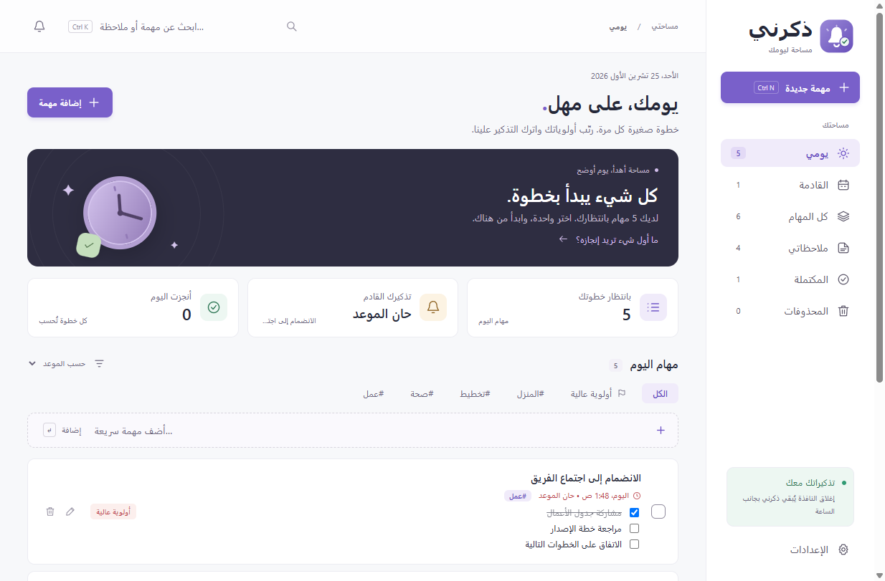
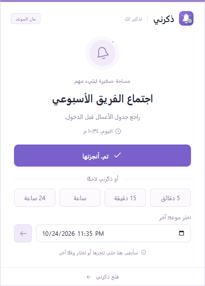

# ذكرني | Remember Me

<p align="center">
  
</p>

<p align="center">
  <a href="https://github.com/sarmadiq9090-coder/Remember-Me/actions"></a>
  <a href="https://github.com/sarmadiq9090-coder/Remember-Me/releases/latest"></a>
  <a href="LICENSE"></a>
  
</p>

تطبيق مهام وملاحظات وتذكيرات مفتوح المصدر لويندوز 64-bit، بواجهة عربية وإنجليزية. يعمل دون حساب أو اتصال دائم بالإنترنت، ويُبقي التنبيه ظاهرًا حتى تنجز المهمة أو تؤجله.

Open-source task, note, and reminder app for 64-bit Windows with Arabic and English interfaces. It works without an account or a permanent internet connection, and keeps reminders visible until completed or snoozed.

<p align="center">
  
  
</p>
<p align="center">
  
  
</p>

## المزايا | Features

- واجهة عربية RTL وإنجليزية LTR قابلة للتبديل من الإعدادات.
- تنبيهات ثابتة فوق شريط المهام مع الإنجاز والتأجيل 5 أو 15 أو 60 دقيقة أو 24 ساعة أو موعد مخصص.
- مهام متكررة يوميًا أو أسبوعيًا أو شهريًا أو سنويًا، أو في أيام محددة مثل أيام العمل، أو كل عدد من الأيام؛ وملاحظات قابلة للبحث بالعربية دون اعتبار للتشكيل والهمزات.
- إرفاق PDF وExcel والمستندات والصور مع معاينة الصور داخل المهمة والملاحظة والتنبيه.
- نسخ احتياطي محلي وإلى مجلد Google Drive المتزامن.
- تخزين محلي، تشغيل مع ويندوز، وعمل في الخلفية بجانب الساعة.

## التشغيل

حمّل أحدث ملف تثبيت من صفحة [Releases](https://github.com/sarmadiq9090-coder/Remember-Me/releases/latest)، ثم افتحه على Windows 10 أو 11 بنواة 64-bit. بيانات المستخدم الشخصية لا تدخل في المستودع أو المثبّت.

### التحقق من الملف | Verify the download

يُبنى المثبّت آليًا عبر GitHub Actions من الكود المنشور نفسه. المثبّت غير موقّع رقميًا بعد، لذلك قد يعرض Windows SmartScreen تحذيرًا «Windows protected your PC»؛ اختر «More info» ثم «Run anyway» بعد التحقق من الملف. قارن بصمة الملف بالقيمة في `SHA256SUMS.txt` المرفق مع الإصدار:

The installer is built by GitHub Actions from the published source. It is not code-signed yet, so Windows SmartScreen may warn before running it. Compare its fingerprint with `SHA256SUMS.txt` from the same release:

```powershell
Get-FileHash .\Remember-Me-Setup-1.4.0-x64.exe -Algorithm SHA256
```

ولمن لديه GitHub CLI، يمكن التأكد أن الملف بُني من هذا المستودع | With GitHub CLI you can also confirm the file was built from this repository:

```powershell
gh attestation verify .\Remember-Me-Setup-1.4.0-x64.exe --repo sarmadiq9090-coder/Remember-Me
```

### لماذا «Waqt»؟ | Why "Waqt"?

«وقت» (Waqt) هو الاسم الداخلي الأول للمشروع، وما زال اسم الملف التنفيذي `Waqt.exe` ومجلد البيانات `%APPDATA%\Waqt` ومعرّف التطبيق `com.waqt.reminder`. أُبقي عليها عمدًا: تغيير المجلد أو المعرّف يفصل البيانات الحالية والتشغيل مع ويندوز والاختصارات عن الإصدارات السابقة. أي تغيير مستقبلي للاسم سيرحّل البيانات تلقائيًا.

"Waqt" (time) was the project's original internal name. It remains in `Waqt.exe`, the `%APPDATA%\Waqt` data folder and the `com.waqt.reminder` app ID on purpose: renaming them would detach existing data, start-with-Windows entries and shortcuts from earlier versions. Any future rename will migrate data automatically.

## الاستخدام

- **مهمة جديدة:** عنوان، ملاحظات، أولوية، وموعد اختياري للتذكير.
- **يومي:** المهام دون موعد، ومهام اليوم، وكل مهمة فات موعدها. **القادمة:** المهام بعد نهاية اليوم.
- **التنبيه الثابت:** يظهر فوق شريط المهام بالشاشة الرئيسية، ويبقى فوق النوافذ حتى تضغط **تم، أنجزتها** أو تؤجّله.
- **التأجيل:** 5 دقائق، 15 دقيقة، ساعة، 24 ساعة، أو تاريخ ووقت تختاره بنفسك. الموعد المؤجّل محفوظ حتى بعد إعادة تشغيل البرنامج.
- **تعدد التنبيهات:** تظهر واحدًا تلو الآخر مع عدد التذكيرات المنتظرة، دون إسقاط أي مهمة.
- **التكرار:** يومي أو أسبوعي. الإنجاز يحفظ سجلًا في «المكتملة» ويحدد الموعد التالي. التأجيل لا يغيّر الساعة الأصلية للتكرار. تُتجاوز المواعيد المتكررة الفائتة إلى أقرب موعد مستقبلي بعد الإنجاز.
- **ملاحظاتي:** ملاحظات يدوية بأربعة ألوان، قابلة للتعديل والبحث والحذف. اضغط «حفظ الملاحظة» لحفظ تعديلاتك.
- **المرفقات:** أثناء كتابة المهمة أو الملاحظة اضغط «إضافة ملفات» واختر PDF أو Excel أو مستندات أو صورًا أو أي ملفات أخرى. يمكنك إضافة 20 ملفًا لكل عنصر، حتى 50 ميغابايت للملف. اضغط «حفظ» لربط الملفات مع النص.
- **معاينة الصور:** تظهر الصور مباشرة مع نص المهمة والملاحظة وداخل نافذة التذكير، وكذلك أثناء التحرير. اضغط الصورة لفتحها بحجمها الكامل بعارض ويندوز. اختُبرت PNG وJPG فعليًا على ويندوز؛ الصيغ الأخرى تعتمد على دعم عارض الصور في النظام. إذا تعذّرت المعاينة يبقى زر فتح الملف متاحًا. معاينة GIF ثابتة، ولا تُعرض ملفات SVG كصور داخل التطبيق.
- **فتح الملفات:** اضغط اسم المرفق من المهمة أو الملاحظة أو نافذة التذكير. يُفتح ببرنامج ويندوز الافتراضي؛ ملفات Excel تحتاج إلى برنامج متوافق مثل Excel. الملفات التنفيذية والبرامج النصية تُعرض في المجلد بدل تشغيلها مباشرة.
- **نسخ مستقلة:** تُنسخ المرفقات إلى مجلد بيانات ذكرني؛ نقل الأصل أو حذفه لا يقطع ارتباط المرفق. إزالة المرفق من عنصر لا تحذف الملف الأصلي أو المرفقات المرتبطة بعناصر أخرى. فتح النسخة وإجراء تعديل عليها في Excel يغيّر النسخة المحفوظة داخل ذكرني.
- **الإعدادات:** صوت التنبيه، تشغيل مع ويندوز، ومكان ظهور التنبيه يمينًا أو يسارًا.
- **اختصارات:** Ctrl+N لإنشاء مهمة أو ملاحظة، Ctrl+K للبحث.

## العمل في الخلفية

إغلاق النافذة الرئيسية يبقي البرنامج بجانب ساعة ويندوز. قد تجد أيقونته ضمن سهم الأيقونات المخفية. انقر عليها لفتح البرنامج، أو استخدم القائمة بالزر الأيمن للخروج الكامل.

فعّل **الإعدادات ← التشغيل مع ويندوز** إذا أردت بدء التذكيرات تلقائيًا عند تسجيل الدخول. هذا الخيار غير مفعّل افتراضيًا.

لن يصدر تنبيه والجهاز مطفأ أو في وضع السكون أو البرنامج متوقف. تظهر التذكيرات الفائتة عند العودة وتشغيل البرنامج. لا يوقظ البرنامج الجهاز من السكون. يستخدم مواعيد وتوقيت جهازك المحلي. لا يظهر فوق شاشة قفل ويندوز الآمنة.

زر الجرس أعلى التطبيق يعرض **تنبيهًا تجريبيًا**؛ التأجيل في المعاينة يغلقها فقط. التذكيرات التي تضيفها للمهام فعلية.

## البيانات والنسخ الاحتياطية

يُحفظ كل شيء محليًا في `%APPDATA%\Waqt\data.json`، مع نسخة سابقة في `data.json.bak`. الإعدادات تعرض المسار الفعلي وزر فتحه. الحفظ ذري، واستعادة النسخة الاحتياطية تلقائية عند تلف الملف الأساسي، مع الاحتفاظ بالملف التالف لفحصه.

من «تصدير نسخة احتياطية» اختر وجهة الحفظ. يُنشئ ذكرني مجلدًا جديدًا يحتوي على `data.json` ومجلد `attachments` بكل الملفات المرتبطة بالمهام والملاحظات، بما فيها المهام المكتملة، وملف `backup.json` ببصمات SHA-256 لكل ملف. للاستعادة اضغط «استعادة من نسخة احتياطية» في الإعدادات واختر مجلد النسخة: يتحقق ذكرني من سلامة الملفات وبصماتها، ويعرض عدد المهام والملاحظات للتأكيد، ويحفظ نسخة أمان من بياناتك الحالية في مجلد `backups` قبل الاستبدال. للاستعادة يدويًا: اخرج من ذكرني من قائمة أيقونة الساعة، احتفظ بنسخة من بياناتك الحالية، ثم انسخ `data.json` ومجلد `attachments` من النسخة الاحتياطية إلى مجلد بيانات ذكرني وافتح البرنامج. لا تعدّل ملف البيانات والبرنامج يعمل.

تُحفظ نسخ المرفقات محليًا أيضًا بعد إزالة ارتباطها، لحماية النسخ الاحتياطية السابقة. النسخة المُصدّرة تشمل الملفات المرتبطة حاليًا فقط. تحديث البرنامج من الإصدار السابق يحتفظ بالمهام والملاحظات والإعدادات تلقائيًا.

## النسخ إلى Google Drive

1. من الإعدادات اضغط **تثبيت Google Drive وتسجيل الدخول**. يفتح موقع Google الرسمي لتثبيت [Google Drive لسطح المكتب](https://www.google.com/drive/download/)، ثم سجّل الدخول بحسابك.
2. داخل Google Drive أنشئ مجلدًا مثل **Waqt Backups**. من ذكرني اختر **اختيار مجلد Google Drive** وحدّد هذا المجلد المتزامن، وليس مجلدًا محليًا عاديًا.
3. اضغط **نسخ احتياطي الآن**. تُحفظ نسخة محلية كاملة في `%APPDATA%\Waqt\backups`، ثم تُنسخ مع الصور والمرفقات إلى مجلد Drive.
4. يرفع Google Drive النسخة إلى حسابك. افتح أيقونته بجانب الساعة أو موقع Drive للتأكد من اكتمال الرفع. رسالة «آخر نسخة إلى مجلد المزامنة» تؤكد النسخ إلى المجلد فقط، ولا تدّعي تأكيد الرفع إلى السحابة.

خيار **نسخة تلقائية كل يوم** ينشئ نسخة كل 24 ساعة أثناء عمل ذكرني. إذا غاب مجلد Drive تبقى النسخة المحلية وتُعاد المحاولة كل 15 دقيقة، أو فور الضغط على إعادة المحاولة. لا يحذف ذكرني نسخك السابقة تلقائيًا. تعمل هذه الميزة ضمن مساحة حسابك، ولا تحتاج إضافة مدفوعة أو إنشاء مفاتيح Google Cloud. تسجيل الدخول والمزامنة مسؤولية تطبيق Google Drive الرسمي؛ [شرح Google للمزامنة](https://support.google.com/drive/answer/13401938).

الاستعادة من نسخة Drive هي نفسها استعادة النسخة المحلية: أوقف ذكرني ثم انسخ `data.json` ومجلد `attachments` كاملًا من النسخة المطلوبة إلى مجلد بيانات ذكرني.

## التطوير والتحقق

التقنية: Electron، JavaScript، HTML/CSS. الواجهة معزولة عن Node.js؛ التخزين والجدولة في العملية الرئيسية، ولا تحمل الواجهة أي موارد من الإنترنت.

```sh
npm install
npm start
npm test
npm run package
npm run installer
```

يتطلب التطوير Node.js 22 أو أحدث. ينتج `npm run package` نسخة محمولة داخل `release/v1.4.0`، وينتج `npm run installer` مثبّت NSIS داخل `release/installer`. مجلدات البناء وبيانات المستخدم مستبعدة من Git.

**إصدار جديد:** حدّث `version` في `package.json`، ثم ادفع tag مطابقًا مثل `v1.4.1`. يشغّل `.github/workflows/release.yml` الاختبارات ويبني المثبّت وينشره في Releases مع `SHA256SUMS.txt` وإثبات البناء (build provenance). توقيع الكود يحتاج حسابًا لدى SignPath (مجاني لمشاريع المصدر المفتوح) أو Azure Trusted Signing أو شهادة مدفوعة؛ عند توفره يُضاف التوقيع إلى خطوة المثبّت.

**Releasing:** bump `version` in `package.json` and push a matching tag such as `v1.4.1`. The release workflow tests, builds and publishes the installer with checksums and build provenance. Code signing needs a SignPath (free for open source), Azure Trusted Signing or certificate account, which can then be added to the installer step.

`tests/core.test.js` يختبر المواعيد والتكرار والتأجيل والحفظ والاستعادة. `tests/desktop-smoke.cjs` يختبر تطبيق ويندوز باستخدام Playwright وبيانات مؤقتة منفصلة، بما في ذلك إخفاء النافذة وبقاء التنبيه والتأجيل والتشغيل من جديد. شغّله بعد تثبيت Playwright للتطوير أو تحديد مساره في `WAQT_PLAYWRIGHT`.

`tests/scheduling.test.js` يختبر التكرار عبر التوقيت الصيفي وتغيّر المنطقة الزمنية وإرجاع ساعة الجهاز، و20 تذكيرًا في الدقيقة نفسها، وتذكيرات يوم كامل فائتة بين آلاف المهام. `tests/ipc.test.js` يختبر قبول الطلبات من صفحات البرنامج نفسها فقط، والإجراءات المسموحة لنافذة التنبيه، وشكل البيانات المرسلة.

`tests/attachments.test.js` يختبر النسخ والاستعادة وترحيل البيانات القديمة والتحقق من المرفقات. `tests/attachments-desktop.cjs` يختبر واجهة مرفقات PDF وExcel والملفات النصية وإزالتها وظهورها في التنبيه والنسخ الاحتياطي. يحتاج إلى Playwright وJSZip (أو `WAQT_PLAYWRIGHT` و`WAQT_JSZIP`). اختيار الملفات وتسليمها إلى تطبيق ويندوز يُختبران بمحاكاة حوار الملفات ومعالج الفتح؛ لا يعتمد الاختبار على تثبيت Excel على الجهاز.

`tests/drive-backup.test.js` يختبر النسخ المحلي ومجلد المزامنة والتعافي عند غياب المجلد. `tests/photos-drive-desktop.cjs` يختبر معاينات PNG وJPG الحقيقية في ويندوز وبقاء النص وأزرار التنبيه وإعدادات Drive والنسخ الكامل. اختبارات Drive تستخدم مجلدًا مؤقتًا لمحاكاة المزامنة؛ لا تدّعي اختبار رفع فعلي لحساب Google قبل تسجيل دخول المستخدم.

## الأفكار المرجعية

استُلهم تنظيم المهام والملاحظات من [TickTick لويندوز](https://www.ticktick.com/windows)، وأزرار الإنجاز والتأجيل من [شرح تذكيراته](https://help.ticktick.com/articles/7055782395743567872). التصميم والكود مستقلان، مع تركيز خاص على تنبيه ثابت وتأجيل إلى موعد مخصص.

## المساهمة والترخيص | Contributing & License

نرحّب بالمساهمات عبر Issues وPull Requests. اقرأ [CONTRIBUTING.md](CONTRIBUTING.md) و[SECURITY.md](SECURITY.md) قبل البدء. المشروع مرخّص وفق [MIT](LICENSE).
